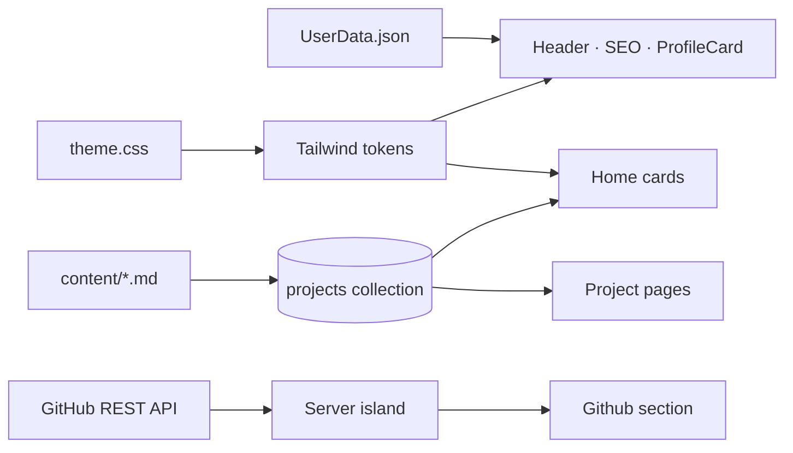

<div align="center">

# Portfolium

**A portfolio and resume that live in two files.**

Change `UserData.json`, drop a Markdown file per project, deploy. No CMS, no database, no build-time rituals.


[Quick start](#-quick-start) · [Where things live](#-where-things-live) · [Customize](#-customize) · [Deploy](#-deploy)

</div>

---

## ✨ What it is

One page that does the job of three: a profile card with your links, a project gallery
fed by Markdown, and a live list of GitHub repositories. Plus a full resume at `/resume`.

Every visual decision is centralized, so the site can be re-skinned or rewritten without
chasing markup:

- **Content-first.** Profile, links and GitHub user in `src/config/UserData.json`. Resume in
  `src/config/UserResume.md`. One Markdown file per project in `src/config/content/`.
- **Motion with restraint.** All GSAP work sits in one module, uses shared easing tokens, and
  turns itself off for `prefers-reduced-motion`.
- **One source of truth per concern.** Sorting in `src/lib/projects.ts`, dates and URLs in
  `src/lib/format.ts`, theme/menu/scroll state in `src/lib/site.ts`. Components stay markup-only.



---

## 🚀 Quick start

```bash
npm install
npm run dev        # http://localhost:4321
```

Three things worth doing before you call it yours:

- [ ] Replace the demo persona in `src/config/UserData.json`
- [ ] Swap the images in `public/img/` and `public/media/ProjectsImg/`
- [ ] Point `siteURL` at the real domain (it feeds canonical + Open Graph tags)

> **Optional.** Copy `.env.example` to `.env` and add a `GITHUB_API_KEY` to lift the GitHub
> request limit from 60/h to 5000/h. Without it the section still renders.

---

## 🗂 Where things live

| File | What it controls |
| :--- | :--- |
| `src/config/UserData.json` | Name, bio, photo, social links, `siteURL`, GitHub API URL |
| `src/config/UserResume.md` | The whole `/resume` page |
| `src/config/content/*.md` | One project each — card, tags, image, and its own page |
| `src/config/theme.css` | Palette, exposed as Tailwind tokens |
| `src/lib/projects.ts` | Project ordering (newest first) |
| `src/lib/animations.ts` | Card reveal, menu timeline, title marquee, reduced motion |
| `src/lib/site.ts` | Theme toggle + persistence, menu state, loading overlay |
| `src/components/UI/ContentPage.astro` | Shared shell for project and resume pages |

---

## 🎛 Customize

<details open>
<summary><b>Profile & links</b></summary>

```json
{
  "siteURL": "https://your-domain.dev",
  "name": "Your Name",
  "shortDesc": "Fullstack Developer",
  "description": "One paragraph, shown on the profile card.",
  "profilePicture": "/img/pp.jpeg",
  "githubAPI": "https://api.github.com/users/<your-handle>",
  "socialLinks": {
    "github": {
      "iconLink": "/img/icons/github-logo.svg",
      "name": "Github",
      "link": "https://www.github.com/<your-handle>"
    }
  }
}
```

`siteURL` may omit the protocol — it is normalized before becoming an absolute URL.
Social links render in object order, so reorder the keys to reorder the icons.

</details>

<details>
<summary><b>Projects</b></summary>

Create `src/config/content/MyProject.md`:

```yaml
---
title: My Project
description: One or two lines shown on the card.
languages: [Astro, TypeScript]
imageUrl: /media/ProjectsImg/my-project.webp
date: 2025-09-28T00:00:00Z
---

Markdown body, rendered at `/MyProject`.
```

The filename becomes the route. Ordering is newest first, everywhere — home grid and side menu.
Dates are formatted in UTC, so `2025-09-28T00:00:00Z` never shifts a day in negative timezones.

</details>

<details>
<summary><b>Resume</b></summary>

Edit `src/config/UserResume.md`. Headings, tables, lists, quotes and code blocks are styled by
`.mdContent` in `src/styles/global.css` — tables scroll horizontally on narrow screens instead of
stretching the page.

</details>

<details>
<summary><b>Colors & fonts</b></summary>

`src/config/theme.css` holds the palette as Tailwind tokens:

```css
@theme {
  --color-primary-500: var(--color-emerald-500);
  --color-bg-dark: var(--color-gray-900);
  --color-fg-dark: var(--color-gray-800);
}
```

Use them directly (`bg-primary-600`, `dark:bg-fg-dark`). Fonts are declared once in
`src/styles/global.css` via `--font-sans` / `--font-mono`, so every element — including
Markdown code — follows them.

</details>

<details>
<summary><b>GitHub section</b></summary>

`GithubRepos.astro` is a **server island**: rendered on demand, after the HTML arrives, with a
spinner as fallback. It reads the user from `githubAPI` and sends the optional token from
`astro:env`. Forks are filtered out, and any API failure degrades to an inline message instead of
taking the page down.

</details>

---

## 🧭 Motion & theme

- The theme is applied by an inline `<head>` script (no flash) and re-applied on
  `astro:after-swap`, because the ClientRouter replaces `<html>` attributes on every navigation.
- Motion is registered once, in `src/lib/animations.ts`, and re-initialized on `astro:page-load`.
- `prefers-reduced-motion: reduce` skips cards, menu and title animations entirely — content
  arrives in its final state.
- The loading overlay persists across navigation and hides itself after page load, with a
  `<noscript>` fallback and a 2.5s safety timer.

---

## 🧱 Project structure

<details>
<summary>Show the tree</summary>

```text
src/
├── config/
│   ├── UserData.json          # profile, links, siteURL, GitHub user
│   ├── UserResume.md          # /resume
│   ├── theme.css              # colors (Tailwind @theme tokens)
│   └── content/*.md           # one file per project
├── content.config.ts          # "projects" collection schema (Zod)
├── lib/
│   ├── animations.ts          # GSAP timelines, menu open/close
│   ├── site.ts                # theme, nav actions, loading state
│   ├── format.ts              # UTC dates + absolute URLs
│   └── projects.ts            # canonical sorting
├── components/
│   ├── UI/                    # Header, ContentCard, ProfileCard, SideMenu...
│   └── Utils/                 # local projects, GitHub repos
├── layouts/Layout.astro       # head, SEO/OG, shell, router
└── pages/
    ├── index.astro            # profile + projects + GitHub
    ├── [...id].astro          # /<project>
    └── resume.astro           # /resume
```

</details>

---

## 📜 Scripts

| Command | Does |
| :--- | :--- |
| `npm run dev` | Dev server on `localhost:4321` (Netlify emulation off — see Deploy) |
| `npm run build` | Production build into `dist/` + Netlify function |
| `npm run preview` | Serve the production build locally |
| `npm run astro -- ...` | Any Astro CLI command |

---

## ☁️ Deploy

<details>
<summary><b>Netlify</b></summary>

The project ships with `@astrojs/netlify`. Connect the repository, keep the defaults
(`npm run build`, publish `dist`), and add `GITHUB_API_KEY` under **Site settings → Environment
variables** if you created one.

Two details handled in `astro.config.mjs`:

- `GITHUB_API_KEY` is declared in `astro:env` as an optional server secret, so builds work with or
  without it.
- `astro dev` disables Netlify's local emulation (`NETLIFY_DEV`), because its bundled edge runtime
  passes a flag that Deno 2.x rejects. Builds are unaffected.

</details>

---

<div align="center">

MIT licensed · Astro 5 + Tailwind 4 + GSAP

</div>
